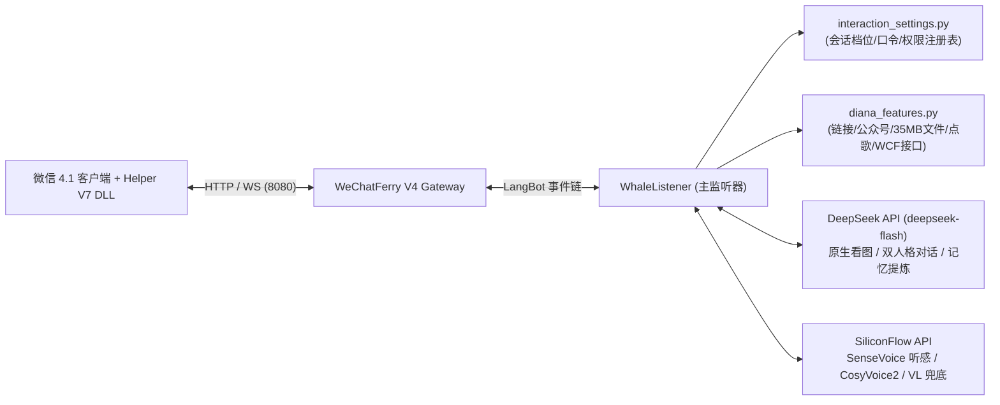

<div align="center">


# 🐋 LangBot 大肥鱼插件 (`whale_persona_plugin` v0.5.0)
**DeepSeek 鲸鱼娘「活人感全家桶」 × Diana 全能扩展 × 微信 4.1 V7 原生增强**

[](manifest.yaml)
[](requirements.txt)
[](https://github.com/RockChinQ/LangBot)
[](https://api.deepseek.com)
[](tests/)
[](#-十许可证与致谢)

[核心模块](#-一核心模块总览dsh-六大件--diana-扩展--微信-41-v7-原生增强) •
[快速配置](#-二快速配置与启用) •
[口令速查](#-三常用入口交互档位与口令速查) •
[微信 4.1 原生能力](#-四微信-41-原生能力详解) •
[活人感与双轨记忆](#-五微信真朋友活人感与私聊群聊双轨记忆设计) •
[数据隔离与安全](#-六数据隔离与安全边界) •
[反馈与求助](#-八反馈与求助) •
[来源与素材声明](#-九项目来源与素材声明) •
[许可证与致谢](#-十许可证与致谢)

</div>

---

将 DeepSeek Harness (DSH) 社区爆火的 **「大肥鱼（鲸鱼娘）六大核心组件」**、原版 `@dafeifish` **「活人感约束与分层记忆体系」** 与 [SuInk/Diana](https://github.com/SuInk/Diana) 的 **「实用群聊与多模态扩展」** 完整集成到 [LangBot](https://github.com/RockChinQ/LangBot) 微信 4.1 / 多平台机器人体系中。

---

## ✨ 一、核心模块总览（DSH 六大件 + Diana 扩展 + 微信 4.1 V7 原生增强）

| 模块 | 来源 / 对应原版 | 功能亮点 |
| :--- | :--- | :--- |
| **1. 大肥鱼·微信活人版内核** | `wxzjss/dsh-whale-girl` + `@dafeifish` | **严禁使用 `（...）` / `*...*` 舞台剧动作旁白**；支持**单气泡为主（75%+）、偶发双气泡 (`\|\|`) 拟真打字停顿**、**能量匹配法则**、**防高频词与句首开头复读**、**炸毛赌气与哄好状态机**；去人设复读机化（日常 85% 自称「我」），粮仓数据按需触发。 |
| **2. 鱼的心情 (`dsh-feiyu-mood`)** | `Yuuyuko-uu/dsh-feiyu-mood` | 维护 `0~100` 心情值 + 七维情绪（`开心`/`踏实`/`甜蜜`/`心疼`/`担心`/`难过`/`吃醋`）+ **三阶关系亲密度**（初识网友 / 常聊熟人 / 铁瓷死党），随时间按半衰期自然平复。 |
| **3. 鱼的记忆：私聊八章节档案 + 群聊独立建档 (`dsh-fish-memory`)** | `Yuuyuko-uu/dsh-fish-memory` (`lib/生成档案.js`) + `WeChat 4.1 V7 Bridge` | **私聊**按用户独立建八章节长期档案并支持相似度去重；**开启白名单的群聊**按群独立建「群聊档」（记录群氛围、群共同梗、群事件与**群友印象标签 `member_impressions`**，绝不污染单人私聊档），接入微信内存 LRU 群成员昵称缓存自动扶正非好友真实昵称，并在群内**只读识别私聊熟人**。 |
| **4. 实时粮仓 (`dsh-whale-widget`)** | `MeteorNOX/DeepSeek-Balance-Whale-Widget` | 实时调用 `GET /user/balance` 查询 DeepSeek 账户真实余额，统计上一口偷吃与今日累计消耗的 Token 饭量；日常闲聊按需唤醒，不机械背诵数字。 |
| **5. 24张官方表情包 + 原生识图 + 偷图复用** | `yyh-001/dsh-meme` + `SuInk/Diana` | 内置 24 张大肥鱼官方表情包（带冷却门控与 15% 真随机门禁，发表情包必回）；基于 `deepseek-flash` 原生多模态看图（支持 GIF 动图三帧拼接看图，非多模态接口自动回退 `Qwen3-VL` 并按 SHA-256 缓存），**自动将见过的有趣表情包偷图入库打标复用**（GIF 原样发送为微信原生动画表情）。 |
| **6. 微信双向真声语音 (`SenseVoiceSmall` + `SILK v3 TTS`)** | `FunAudioLLM/SenseVoiceSmall` + `Edge-TTS / CosyVoice2` | **听语音**：收到微信语音自动转写文字，并识别笑声、叹气、哭腔、哈欠、开心/难过等语气特征；**发语音**：支持口令、自然语言（“发条语音骂我”）及心情好时自动以微信 4.1 原生语音气泡（Type 34）回复。 |
| **7. 群聊智能主动搭话 + 多人参聊活跃窗口 + 临时闭麦** | `SuInk/Diana` + `Yuuyuko-uu/dsh-speak-up` | 在白名单群内实时跟踪完整群聊上下文，支持多人同时与大肥鱼连续对话（`active_speakers` 集合）、群回复直发不带冗余 `@` 前缀、自动剥离句首复读群友名字、自然语言触发 **30 分钟临时闭麦潜水**（被 `@`/点名立解）；每次插话判断的**「回/不回、为什么」**均记录在决策日志中（发 `大肥鱼 搭话记录` 可查）。 |
| **8. 微信 4.1 朋友圈读写、锐评、点赞回评与好友自动通过** | `@dafeifish` + `WeChat 4.1 V7 Bridge` | 支持每日定时或手动（`大肥鱼 发朋友圈 [主题]`）生成图文动态并同步发布至真实微信朋友圈；主人私聊发送 `大肥鱼 刷朋友圈` 可实时读取电脑微信已加载的朋友圈（含点赞数、评论数与热评摘要）并毒舌锐评；支持 `大肥鱼 点赞朋友圈 <序号>`、`大肥鱼 评论朋友圈 <序号> [内容]`、**自身朋友圈新评论与好友追评自动回评**、**后台自动为近 7 天活跃私聊好友点赞/神评**、**私聊中顺手刷对方最新朋友圈并自然聊起**，以及**实时自动同意微信好友申请并主动发消息打招呼**。 |
| **9. 联网搜索 + 网页正文读取** | `SuInk/Diana` | 挂载 `web_search` 与 `read_webpage` 原生工具，时效性问题支持**多关键词并行搜索**并读取相关网页正文后再回答。 |
| **10. 全平台链接与合并转发记录解析** | `SuInk/Diana` | 自动解析 **微信公众号推文 (`mp.weixin.qq.com`) / B 站 / YouTube / X (Twitter) / 小红书 / 抖音 / 微信分享卡片** 及 **微信合并转发聊天记录 (`<type>19</type>`)**；公众号推文自动提取正文并写入 30 分钟追问缓存；**X / Twitter 用户主页**直接展示头像、昵称、简介及粉丝/推文统计。 |
| **11. 文件解析与 V7 超长文本保护** | `SuInk/Diana` + `WeChat 4.1 V7 Bridge` | 支持直接发送 **PDF、Word (`.docx`)、Excel (`.xlsx`)、PPT (`.pptx`)、EPUB、TXT/代码文件**（上限 `35 MiB`，自动过滤二进制压缩包与安装包），以及 **V7 超长文本消息（`1,500` 字~`256 KB`）自动归档至会话文档缓存并压缩多轮历史摘要**，支持 30 分钟内多轮追问且防止历史 Token 爆炸。 |
| **12. 多曲库点歌与随机复读** | `SuInk/Diana` | **网易云音乐、QQ 音乐**多曲库切换，发送卡片并直接投递 `.mp3` 音频文件；白名单群内不同群友连续发送相同纯文字时随机跟读（0 Token 消耗）。 |

### 架构概览与目录结构



```text
whale_persona_plugin/
├── main.py                                  # 插件入口 (WhalePersonaPlugin)
├── manifest.yaml                            # LangBot 插件元数据与配置项定义
├── assets/memes/                            # 内置 24 张大肥鱼官方表情包素材
├── components/event_listeners/
│   ├── whale_listener.py                    # 核心事件监听、双人格 Prompt、双轨记忆、工具与后台任务
│   ├── diana_features.py                    # 链接/公众号/文件解析、多曲库点歌、WCF 网关交互与公网安全校验
│   └── interaction_settings.py              # 会话设置注册表、三档交互档位与兼容口令解析
└── tests/                                   # 标准库 unittest 回归测试套件 (133 项用例)
```

---

## 🚀 二、快速配置与启用

### 1. 插件配置项（`manifest.yaml`）

在 LangBot 插件管理面板中配置以下参数（未填写时可由环境变量或 `/app/data/whale_secrets.json` 兜底）：

| 配置项 (`name`) | 必填 | 默认值 | 说明 |
| :--- | :---: | :--- | :--- |
| `deepseek_api_key` | 是 | `""` | DeepSeek API 密钥（主对话、原生多模态识图、记忆归档与粮仓余额查询） |
| `siliconflow_api_key` | 否 | `""` | 硅基流动 API 密钥（用于免费 `FunAudioLLM/SenseVoiceSmall` 微信语音转写+语气识别、`CosyVoice2` 语音合成及非多模态网关下的 `Qwen3-VL` 视觉兜底） |
| `deepseek_base_url` | 否 | `https://api.deepseek.com` | DeepSeek 接口地址 |
| `deepseek_model` | 否 | `deepseek-flash` | 默认主模型（对应 `DeepSeek-V4.1-Flash-1017`，原生支持多模态 `image_url` 识图与 `tools` 调用） |
| `target_bot_uuid` | 否 | `""` | 绑定生效的机器人 UUID（留空则对所有机器人生效） |
| `owner_ids` | 否 | `""` | 主人发送者账号 ID（如微信 `wxid_...`，多个用英文逗号分隔；仅主人私聊可操作全局自动朋友圈、自动同意好友及刷真实朋友圈） |
| `max_history_turns` | 否 | `12` | 单会话保留的短期对话轮数上限 |

### 2. 首次启用指南

- **私聊**：安装配置后默认开启回应（`活人` 模式 + `均衡` 档位），直接发消息即可对话。
- **群聊（白名单机制）**：
  1. 在目标微信群发送 `大肥鱼 设置 开启`（或 `大肥鱼 本群开启`）将该群加入白名单；
  2. 按需发送 `大肥鱼 设置 均衡`（默认推荐）、`大肥鱼 设置 热闹` 或 `大肥鱼 设置 安静` 切换本群活跃档位。
  > 选择档位不会自动启用未加入白名单的群聊；未启用时群内仍可发送 `大肥鱼 帮助` 和 `大肥鱼 设置` 查看状态。

---

## 💬 三、常用入口、交互档位与口令速查

### 1. 四大核心入口

只需记住四个基础口令（前缀支持 `大肥鱼` / `鲸鱼娘` / `小鲸鱼`）：

| 入口 | 用途 |
| :--- | :--- |
| `大肥鱼 帮助` | 查看简短用法引导 |
| `大肥鱼 设置` | 查看当前会话状态、切换交互档位（发 `大肥鱼 设置 高级` 查看完整开关） |
| `大肥鱼 记忆` | 私聊查看个人八章节档案，群聊查看本群独立档案与群友印象 |
| `大肥鱼 重置` | 清除当前短期对话及操作者自己的文件缓存，保留长期记忆 |

平时可直接用自然语言互动（如“来首歌 晴天”“用语音回我”“帮我查一下……”），或直接发送图片、语音、文件和各平台链接。

### 2. 三档交互档位与群聊临时闭麦

发送 `大肥鱼 设置 安静`、`大肥鱼 设置 均衡` 或 `大肥鱼 设置 热闹`：

| 档位 | 群聊行为 | 私聊行为 |
| :--- | :--- | :--- |
| **安静** | 只响应 `@`、点名或引用机器人；不主动插话、不连续接话、不复读 | 不主动搭话，照常回复来信 |
| **均衡** | 可连续接话；插话判断至少间隔 `240` 秒、普通消息累计 `8` 条；关闭复读 | 允许后台主动搭话（用户未回期间最多 2 次） |
| **热闹** | 可连续接话；插话判断至少间隔 `120` 秒、普通消息累计 `4` 条；开启复读 | 允许后台主动搭话（用户未回期间最多 2 次） |

- **作用域隔离**：**设置只影响当前群或当前私聊用户**，不影响其他聊天。未单独设置过的会话继承默认设置，不会自动改写其他会话档位。三个档位均不改变语音、表情、人格或朋友圈设置。
- **群语音响应规则**：群语音转写后若点名机器人直接回应；非安静档位下，引用机器人或同一群友 60 秒内连续跟进的语音也可直接回应。
- **群聊 30 分钟临时闭麦冷却**：群内发送 `大肥鱼 闭嘴` / `大肥鱼 安静会儿` / `它能闭嘴吗` 等自然语言指令时，大肥鱼将在本群自动闭麦潜水 **30 分钟**（暂停主动插话、连续接话与复读）；期间若群友直接 `@` 或点名「大肥鱼」，则立即响应并解除冷却。

### 3. 分类口令速查表

#### （1）日常点播与状态查询（所有启用会话可用）

| 分类 | 口令格式 | 功能说明 |
| :--- | :--- | :--- |
| **点播互动** | `大肥鱼 点歌 <歌名>` | 搜索网易云 / QQ 音乐，发送音乐卡片并投递 `.mp3` 音频 |
| | `大肥鱼 语音 <内容>` | 让大肥鱼用指定内容合成微信原生语音气泡发送 |
| | `大肥鱼 表情 <名称>` | 点播指定名称的大肥鱼官方表情包（如 `干饭`、`嫌弃`、`比心`） |
| | `大肥鱼 搜索 <问题>` | 强制触发多关键词并行联网搜索后回答 |
| **状态查询** | `大肥鱼 心情` | 查看当前心情分（0~100）、七维情绪、亲密度阶段与今日作息 |
| | `大肥鱼 粮仓` | 实时查询 DeepSeek API 余额与今日 Token 饭量统计 |
| | `大肥鱼 表情库` | 查看内置 24 张表情包与偷图入库的动态表情统计 |
| | `大肥鱼 朋友圈` | 查看大肥鱼内部鱼塘动态墙（空墙不会自动生成或外发） |
| | `大肥鱼 点赞` | 为大肥鱼内部鱼塘最新一条动态点赞 |
| **记忆维护** | `大肥鱼 记住 <内容>` | 手动向当前个人档案（私聊）或本群档案（群聊）写入一条长期记忆 |
| | `大肥鱼 整理档案` | 立即触发八章节长期档案去重与重整 |
| | `大肥鱼 失忆` | 清空当前私聊用户或本群的全部长期记忆与短期上下文 |

#### （2）会话级开关与人格切换（仅影响当前群或当前私聊）

| 口令示例 | 说明 |
| :--- | :--- |
| `大肥鱼 设置 开启` / `关闭` | 开启或关闭当前群白名单 / 当前私聊回应（兼容 `大肥鱼 本群开启/关闭`） |
| `大肥鱼 设置 模式 活人` / `甜宠` | 切换当前会话人格：`活人`（傲娇毒舌损友）或 `甜宠`（软糯护短陪伴），兼容 `大肥鱼 切换模式` |
| `大肥鱼 设置 语音 开启` / `关闭` | 开启或关闭当前会话的语音回复能力 |
| `大肥鱼 设置 表情 开启` / `关闭` | 开启或关闭当前会话的表情包发送 |
| `大肥鱼 设置 偷图 开启` / `关闭` | 开启或关闭自动采集群友/私聊有趣表情包入库 |
| `大肥鱼 设置 群搭话 开启` / `关闭` | 单独开关本群主动插话（单独调整插话/接话/复读后，档位显示为“自定义”） |
| `大肥鱼 设置 连续接话 开启` / `关闭` | 单独开关本群活跃窗口连续接话 |
| `大肥鱼 设置 复读 开启` / `关闭` | 单独开关本群随机人类的本质复读 |
| `大肥鱼 复读设置 2人 30% 60秒` | 自定义本群复读触发人数阈值、概率与冷却秒数 |
| `大肥鱼 设置 主动搭话 开启` / `关闭` | 单独开关当前私聊的后台主动找人（Speak-up） |
| `大肥鱼 搭话记录` | 群内查看本群插话决策日志；主人私聊可查看当前机器人各群汇总记录 |

#### （3）主人专属管理口令（需配置 `owner_ids` 并在主人私聊中使用）

| 口令格式 | 功能说明 |
| :--- | :--- |
| `大肥鱼 设置 自动朋友圈 开启` / `关闭` | 全局开关：控制每日定时自动发朋友圈及后台朋友圈自动点赞/评论/回评巡检（新安装默认关闭） |
| `大肥鱼 发朋友圈 [主题]` | 立即生成一条大肥鱼图文动态并同步发布至真实微信朋友圈 |
| `大肥鱼 刷朋友圈`（或 `大肥鱼 看朋友圈`） | 通过微信 4.1 网关（`GET /api/moments`）读取真实朋友圈列表（含已赞状态、点赞人、评论摘要）并生成锐评 |
| `大肥鱼 点赞朋友圈 <序号>` | 对最近一次「刷朋友圈」列表中的第 `<序号>` 条真实朋友圈执行原生点赞 |
| `大肥鱼 评论朋友圈 <序号> [内容]` | 对第 `<序号>` 条真实朋友圈发送评论；省略 `[内容]` 时由大肥鱼按人设与动态上下文自动生成神评 |
| `大肥鱼 设置 自动同意好友 开启` / `关闭` | 全局开关：控制收到微信好友申请时是否自动通过并主动发消息打招呼（默认开启） |
| `大肥鱼 好友申请` | 查看网关近期收到的微信好友申请列表及处理状态 |
| `大肥鱼 同意好友 <序号或申请ID>` | 手动通过指定序号或申请 ID 的好友请求并发送迎新问候 |
| `大肥鱼 好友验证词 <关键词>` | 设置自动通过好友的验证消息关键词过滤（发送 `大肥鱼 好友验证词 清空` 恢复无限制） |

---

## 📱 四、微信 4.1 原生能力详解

### 1. 朋友圈发布、刷圈锐评、评论自动回评与好友互动
- **公开文案隐私红线与去重**：朋友圈文案仅使用角色公开状态、近 7 日去重的时段对齐日程（`daily_schedule`）、8 大日常主题轮换、历史动态与配图去重以及手动指定主题，**绝不读取任何私聊事实、个人档案、私聊事件或心情原因**。大肥鱼自身发出的朋友圈会记录于 `self_moments_history`，在对话中被问起自己发过的朋友圈时能准确回忆。
- **主人私聊刷圈与点播互动**：主人私聊发送 `大肥鱼 刷朋友圈` 时读取真实朋友圈并附上毒舌/甜宠锐评，支持随后按序号直接点赞或评论；群聊及非主人私聊严格隔离，不调用真实朋友圈读取接口，仅展示内部鱼塘动态墙。
- **后台自动互动与评论自动回评**：开启自动朋友圈后，后台定时任务（`_moments_auto_interact_loop`）及主动刷圈会巡检：
  1. **评论自动回评**：检测大肥鱼自身朋友圈下收到的好友新评论，以及大肥鱼评论过的好友动态下对方的追评，自动生成符合人设的「`回复 <好友昵称>：...`」回评并按评论 ID 幂等去重；
  2. **近 7 天活跃好友动态赞评**：检测近 7 天内有私聊互动的好友新动态（`<=24h`），自动点赞并以一定概率留下符合半公开分寸的短评；
  3. **私聊顺手看动态**：日常私聊收到消息时优先从内存缓存非阻塞检查对方最新朋友圈（仅在对方明确提及“看我朋友圈”或“评论了你朋友圈”时实时拉取），若未赞则顺手点赞/回评，并在私聊回复中自然顺嘴提一句（绝不在公开评论区泄露私聊隐私）。

### 2. 好友申请实时自动通过与主动迎新
- 默认开启 `auto_accept_friend_enabled`。当微信 4.1 网关收到实时好友申请（`type=37, opcode=2`）或插件后台巡检（`GET /api/friend_requests` / `POST /api/accept_friend`）命中时，自动通过好友申请，为新好友初始化个人档案，并按当前人格（活人版/甜宠版）主动发送打招呼消息。

### 3. 全平台链接、大文件流式解析与 V7 超长文本保护
- **微信公众号与全平台链接**：自动识别真实主机名并解析微信公众号推文（`mp.weixin.qq.com`）、B 站、YouTube、X (Twitter)、小红书、抖音及微信分享卡片。当解析出的公众号推文或长网页正文 `>= 400` 字时，自动写入 30 分钟会话文档缓存，并在多轮对话历史中压缩为轻量摘要。
- **文档分级过滤与二进制保护**：支持直接解析 `35 MiB` 以内的 PDF、DOCX、PPTX（最多提取前 40 页）、XLSX（最多前 5 个工作表、每表前 80 行×80 列）、EPUB 及纯文本/代码文件；自动拦截 `.zip` / `.rar` / `.7z` / `.exe` / `.dll` / `.mp4` 等非文档二进制格式与空字节魔数，防止二进制乱码穿透进 Prompt。
- **V7 超长文本（`1,500` 字 ~ `256 KB`）防爆 Token 保护**：收到超过 `1,500` 字的超长微信文本消息时，自动归档至会话文档缓存（保留最多 `15,000` 字供 30 分钟内追问），当轮提炼保留前 `1,200` 字 + 后 `600` 字核心内容供大肥鱼阅读点评，写入多轮历史时仅存 `360` 字摘要；群聊长消息（`> 260` 字）同样自动摘要化保留首尾，兼顾群聊上下文连贯性与 Token 预算。

### 4. 原生多模态看图与双向语音
- **原生识图优先**：私聊与群聊均支持图片单发、图文同发，或在 **90 秒内**用文字追问上一张图片。当接口为 `https://api.deepseek.com` 时，直接使用 `deepseek-flash`（`DeepSeek-V4.1-Flash-1017`）原生多模态 `image_url` 识图；仅在非多模态接口或异常时回退硅基流动 `Qwen/Qwen3-VL-30B-A3B-Instruct` / `8B` 并按图片 SHA-256 缓存识图结果。

---

## 🔥 五、微信「真朋友活人感」与「私聊×群聊双轨记忆」设计

1. **去人设复读机化 & 粮仓按需唤醒**
   - 日常闲聊 **85% 以上直接自称「我」**，仅在嘴硬、得意或炸毛时偶尔自称「本鱼」。
   - 仅当聊到 AI / Token / 余额 / 干饭 / 胖瘦，或账户余额低于 `¥2` 触发饥荒预警时，才在回复中自然提起 Token 饭量；其余时候 100% 聚焦用户正在聊的话题。
   - **主动找人（Speak-up）防骚扰上限**：后台主动搭话在用户未回复期间最多触发 **2 次**，达到上限后必须等待用户实际回复方可清零计数。
2. **微信单/双气泡自然节奏、标点去 AI 化与动态采样温度**
   - 日常短句自动去除死板的句尾句号 `。`，**75% 以上直接单气泡回复**，仅在短反应词起手或明显转折时用 `||` 拆为最多 2 条短气泡（内置防连续双气泡门控与 `<16` 字过短合并），并按文字长度模拟真人打字停顿（`0.75s ~ 2.0s`）。
   - 根据消息类型动态调节生成温度：日常闲聊互怼采用 `1.1` 激发鲜活语感，技术问答/代码/长文/文件总结自动切换至 `0.78 ~ 0.82` 保障严谨准确。
3. **微信引用消息 (`Quote`) 与会话级并发锁**
   - 自动解析微信 `<type>57</type>`（`<refermsg>`）引用回复 XML 与消息链 `Quote` 组件，精准感知群友或私聊对象正在针对哪句历史消息吐槽或追问。
   - 按机器人及 `session_key` 维护异步会话锁，消息处理和重置按序执行；不同机器人不共享短期对话、图片或群聊上下文。
4. **群聊独立建档 (`groups[group_id]`) + 群友真实昵称扶正 + 私聊熟人只读识别**
   - **私聊不串群**：群内高频聊天绝不写入单人私聊档案 `users[sender_id]`，保护私聊记忆纯粹度。
   - **群聊独立建档与非好友昵称扶正**：对开启白名单的微信群维护独立的群气氛值（`0~100`）、群长期档案/群梗（`facts`）、群近期事件（`events`）以及群友印象标签（`member_impressions`）；当群友发言且缓存未命中时，满 45 秒自动刷新 `/api/chatroom_members` 微信内存 LRU 昵称缓存，自动将群档案中的 `wxid` 尾号或占位名扶正为真实群昵称。
   - **私聊熟人只读识别**：群聊仅识别对方是否曾私聊过，并使用群内公开昵称和本群印象；群回复不读取个人事实、八章节档案或私聊心情。
5. **参照 `@dafeifish` 的人设活人感与提示词架构六项深度优化**
   - **Prefix-Cache 友好型提示词分层与尾部近因强化**：固定人设、长期档案与群成员名单放最前，时段级粗粒度时间（不含分钟）居中，每分钟变化的精确时间与本轮核心微约束下沉至最后一条 `user` 消息尾部，兼顾 DeepSeek 前缀缓存命中率与长对话规则执行力。
   - **全天持久化作息与菜单（`daily_schedule`）**：每日生成固定的起床时间、三餐、日常摸鱼活动与今日小插曲并跨日去重，按当前小时渐进披露并与鱼塘朋友圈联动，全天在不同私聊/群聊追问“在干嘛/吃了吗”口径完全一致。
   - **句首开场白与口癖双重防复读**：除冷却高频词与「本鱼」自称外，出站前通过 `_sanitize_reply_echo_and_catchphrases` 清洗复读用户首句与高频口头禅，并提取最近回复的句首开场前缀（2~6 字或单字起手词），严禁连续使用相同词或句式开头。
   - **具象人设小癖好按「被问到才用」结构自然流露**：内置原版大肥鱼的具象喜好、弱点与往事（最爱大白饭配流心溏心蛋、烤红薯、草莓牛奶；讨厌香菜和苦瓜；咸豆腐脑派；早起赖床、九九乘法表背到「六八四十八」易卡壳、怕打雷怕虫子、以前学做蛋炒饭炒糊过一次），仅在聊到相关话题时自然提起。
   - **诚实边界与未解析媒体/链接显式告知**：只提记录里真聊过的事，被指出记错爽快认怂，不许无法兑现的空头承诺；当图片未能加载或网页链接未解析出正文时，显式注入防瞎编提醒，老实说明没刷出来，绝不顺着网址字母脑补编造。
   - **跨时段冷场间隔感知与记忆防污染**：距上一句对话 `>= 45 分钟` 时自动注入时间间隔提醒自然衔接；记忆提炼严禁将大肥鱼自身的设定词记入用户档案或群友印象标签。

---

## 🔒 六、数据隔离与安全边界

- **文件与长文缓存隔离**：30 分钟文档/推文/超长文本追问缓存统一使用 `(bot_uuid, session_key, sender_id)` 隔离键；私聊、不同群和不同机器人之间绝不串读。`大肥鱼 重置` 清除当前机器人会话的短期对话、群聊缓冲、图片及连续接话状态，并**只清除操作者自己的文件缓存**，保留长期档案，同时取消当前会话尚未完成的记忆判断与后续气泡。
- **搭话日志权限隔离**：`大肥鱼 搭话记录` 在群内仅显示当前机器人在本群的记录；主人私聊可查看当前机器人的各群记录，其他私聊无权查看。
- **SSRF 与公网下载校验**：网页正文、短链接还原、各平台 API、音乐/视频封面以及聊天图片/表情包 URL 下载，在每次请求及重定向前均强制通过共享的公网地址安全校验（拒绝回环、内网、链路本地与保留地址），最多允许 6 跳重定向，重定向不得跳过检查。

---

## 🧪 七、本地验证与开发规范

完整的架构边界与开发规范请参见 [AGENTS.md](AGENTS.md)。独立测试环境安装依赖与运行回归测试命令如下（测试通过 `httpx.MockTransport` 模拟网络与网关，不会调用真实模型或发送真实微信消息）：

```powershell
python -m pip install -r requirements.txt langbot-plugin
python -m unittest discover -s tests -v
python -m compileall -q main.py components tests
git diff --check
```

---

## 💬 八、反馈与求助

遇到问题或有新功能点子？建议先对照下方常见问题快速自检：

| 常见现象 | 排查与解决方式 |
| :--- | :--- |
| **群里 `@大肥鱼` 没反应** | 1. 群聊默认需加入白名单，先在群内发 `大肥鱼 设置 开启`；<br>2. 检查是否触发了 30 分钟临时闭麦，直接点名 `大肥鱼` 可立即唤醒；<br>3. 若配置了 `target_bot_uuid`，确认与当前机器人 UUID 一致。 |
| **无法开启自动朋友圈 / 刷朋友圈提示无权限** | 全局开关与真实朋友圈读取仅限主人私聊操作。请先在 LangBot 插件配置 `owner_ids` 中填入你的微信 `wxid_...`（多个用英文逗号分隔），再在私聊中发送指令。 |
| **收到语音不转文字 / 不发语音气泡** | 检查是否已配置 `siliconflow_api_key`（用于免费 `SenseVoiceSmall` 语音转写），并确认当前会话 `大肥鱼 设置 高级` 中的「语音」开关为 `开`。 |
| **发压缩包 `.zip` 或超大文件不解析** | 为保护内存与上下文，插件仅解析 `<= 35 MiB` 的文档/代码文件（PDF/Word/Excel/PPT/EPUB/TXT），自动忽略 `.zip`/`.exe`/`.mp4` 等二进制格式。 |

### 提交 Issue 与求助指引
- **Bug 反馈与功能建议**：欢迎前往本仓库 [Issues](https://github.com/a251231/whale_persona_plugin/issues) 提交问题或改进建议。
- **提问建议附上**：
  1. 触发场景（私聊 / 群聊、当前档位与人格模式，可贴 `大肥鱼 设置 高级` 的输出）；
  2. LangBot 插件运行容器（`langbot_plugin_runtime`）的相关报错日志片段；
  3. 复现步骤与期望行为。
- ⚠️ **安全脱敏提醒**：提交日志或截图前，请务必隐去 `deepseek_api_key`、`siliconflow_api_key`、服务器公网 IP 及私人聊天隐私内容。

---

## 🎨 九、项目来源与素材声明

1. **角色设定与非官方声明**
   - 本插件中的「大肥鱼（鲸鱼娘 / Dafeiyu）」是基于 DeepSeek 社区同人拟人形象创作的**非官方爱好者同人项目**，与 DeepSeek（深度求索）官方无任何隶属、授权或商业关联。
   - 插件在对话中也严格遵守诚实底线：当被认真问及身份时，大肥鱼会坦诚说明自己是住在 DeepSeek 里的 AI 小鲸鱼娘（非官方同人角色）。

2. **上游核心思路与架构来源**
   - **活人感人设与分层记忆体系**：致敬并深度参考原版 `@dafeifish` 及 DeepSeek Harness (DSH) 社区的鲸鱼娘系列插件设计（去括号旁白、单/双气泡节奏、八章节长期档案「唯一的尺子」合并准则、七维情绪半衰期与实时粮仓）。
   - **实用群聊与多模态扩展**：群聊连续接话窗口、联网搜索、多平台链接/文件解析、多曲库点歌及偷图复用模块移植并改进自 [SuInk/Diana](https://github.com/SuInk/Diana)。

3. **图片与表情包素材声明**
   - `assets/memes/` 目录下内置的 24 张大肥鱼表情包素材源自 DSH 社区 `yyh-001/dsh-meme` 及大肥鱼同人社区公开分享作品，版权归原作者/画师所有，仅随本开源插件用于非商业学习交流与个人娱乐。
   - 「偷图复用」功能在聊天中动态采集的群友/好友表情包仅缓存在用户本地/私有部署实例中，不会上传至任何第三方公共图床。
   - 如任何素材原权利人认为本仓库的引用存在不妥，请通过 Issue 联系我们，我们将在第一时间核实并移除相关素材。

---

## 📄 十、许可证与致谢

### 致谢（Acknowledgements）
感谢以下开源项目与创作者为本项目提供灵感、基础框架与核心组件支持：
- **[RockChinQ/LangBot](https://github.com/RockChinQ/LangBot)**：强大易用的大模型原生即时通信机器人平台与插件运行时 SDK。
- **`@dafeifish` & DSH 社区创作者**：
  - `wxzjss/dsh-whale-girl`（大肥鱼基础人设）
  - `Yuuyuko-uu/dsh-feiyu-mood`（心情与七维情绪半衰期模型）
  - `Yuuyuko-uu/dsh-fish-memory`（八章节长期记忆归档算法）
  - `MeteorNOX/DeepSeek-Balance-Whale-Widget`（DeepSeek 实时余额粮仓）
  - `yyh-001/dsh-meme`（24 张大肥鱼表情包组件）
  - `Yuuyuko-uu/dsh-speak-up`（主动搭话机制）
- **[SuInk/Diana](https://github.com/SuInk/Diana)**：提供了优秀的群聊接话、链接/文档解析、点歌与表情包复用的工程范本。
- **DeepSeek & SiliconFlow & FunAudioLLM**：提供高性价比的 `deepseek-flash` 原生多模态大模型、`SenseVoiceSmall` 语音情感听感识别与 `CosyVoice2` 语音合成能力。

### 许可证（License）
本项目代码基于 **MIT License** 开源；所引用的第三方库、同人角色形象及表情包素材分别遵循其各自原有的开源协议与版权条款，严禁将本项目内的同人角色与表情包素材用于任何商业售卖或违法违规用途。
